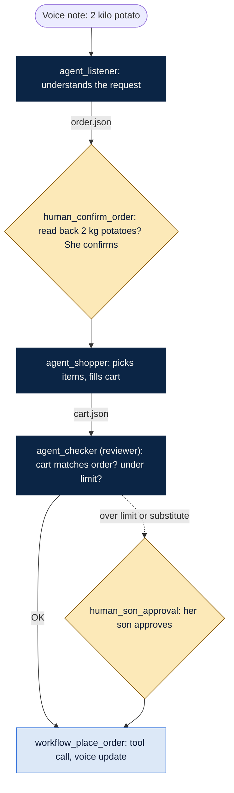

# Team worksheet: design an agent team

You will **design** a team of AI agents for one business question. You will not build or run it today.
Read the [data card](DATA_CARD.md) first.

## The rules

- **3 to 5 steps**: agents (need judgment) or workflow steps (always do the same thing). Plus **1 reviewer agent** (required). The reviewer did not do the work and checks it.
- Every arrow between agents passes a **named file** (for example `orders_joined.csv`).
- Put a **check** on your **3 most important hand-offs**.
- Add at least **one human stop**: a point where a person must decide before the team goes on.

## Pick one question card

1. **About 15% of reviews are 1 or 2 stars. Which one fix should Olist fund:** faster delivery, cutting bad sellers, or better product listings?
2. **Which sellers should Olist cut, coach, or reward?**
3. **Should Olist promise 7-day delivery across Brazil?**
4. **Build a Monday-morning customer health report** that runs every week.
5. **Turn Portuguese customer complaints into action tickets** for the right team. Refunds need a human to approve.

## What you hand in (3 parts)

### 1. Diagram (Mermaid)
Describe your design to any AI chat and paste this:

```
Turn this agent design into a Mermaid flowchart (flowchart TD).
Use three step types. Name each box with its type first, using underscores:
- agent_<name> (AI makes a judgment), e.g. agent_reviewer: dark navy box, white text.
- workflow_<name> (a fixed rule, script or tool call), e.g. workflow_join_tables: light blue box.
- human_<name> (a person decides), e.g. human_refund_approval: gold diamond.
Put the file each step hands over on the arrow.
Show steps that only happen sometimes as dotted arrows.
Use these classDef lines:
classDef agent fill:#0B2545,stroke:#0B2545,color:#F6F3EC
classDef workflow fill:#DCE8F7,stroke:#2F6FDB,color:#14213D
classDef human fill:#FCE9B8,stroke:#8A5A00,color:#14213D
Design: <describe your steps, files, checks and human stops>
```

View it at [mermaid.live](https://mermaid.live). Take a screenshot for your slide.

**Agent or workflow?** If the step needs judgment (reading text, choosing, writing, checking), it is an agent. If it always does the same thing (joining tables, computing a fixed metric, sending a file), it is a workflow step.

**Example:** a voice shopping assistant (not an Olist card), drawn this way. Paste it into mermaid.live to see it.



### 2. Agent prompts (2 lines each)
For every agent, including the reviewer:

| Agent | Line 1: your job | Line 2: your limits |
| --- | --- | --- |
| Example: Data agent | Join orders, payments, reviews and customers into one row per order. | Never change the raw files. Stop and ask if more than 2% of orders fail to join. |
| | | |

### 3. One-page defense
Answer each in 1 to 3 lines, in this order:

1. **The problem we chose:** the card number and question.
2. **The problem in plain English:** who is asking, what they must decide, and what “done” looks like for them.
3. **What we plan to do:** the approach in a few steps, before any agents.
4. **Our agent architecture:** your diagram, plus:
   - **Checks:** what is checked at your 3 most important hand-offs, and how.
   - **Human stops:** where a person must decide, and why there.
   - **Reviewer:** what it checks that the other steps cannot check themselves.
5. **Why this design:** why these steps, and why each is an agent or a workflow step.
6. **Pros:** 2 strengths of your design.
7. **Risks:** 2 ways your design could fail, or give a wrong answer.
8. **The alternative:** one other design you considered, and why you did not choose it.

**Use what you learned in Session 1.** Your design should still have what made the $2M analysis trustworthy: a clear brief, stop-and-ask rules, a reviewer that did not do the work, and evidence for every number.

## What makes a good design

| Test | Good sign | Warning sign |
| --- | --- | --- |
| **Every agent earns its place** | You can say what breaks if you remove it | Two agents do almost the same job |
| **One clear job each** | Each job fits in one sentence | An agent "does the analysis" |
| **Concrete hand-offs** | Each arrow passes a named file | Arrows say "sends info" |
| **Real checks** | A check someone could run: row counts, join rate, read 20 samples | "The AI double-checks" |
| **Independent review** | The reviewer did not do the work | Agents only check their own work |
| **Humans where it matters** | A person decides before money, people or customers are affected | No human stop, or a stop at every step |
| **Answers the question** | Ends in a decision or a report someone will use | Ends in "insights" |

Start simple. Anthropic's advice for agent systems: use the simplest design that works, and add agents only when the task needs them.
Source: [Building effective agents](https://www.anthropic.com/engineering/building-effective-agents).
